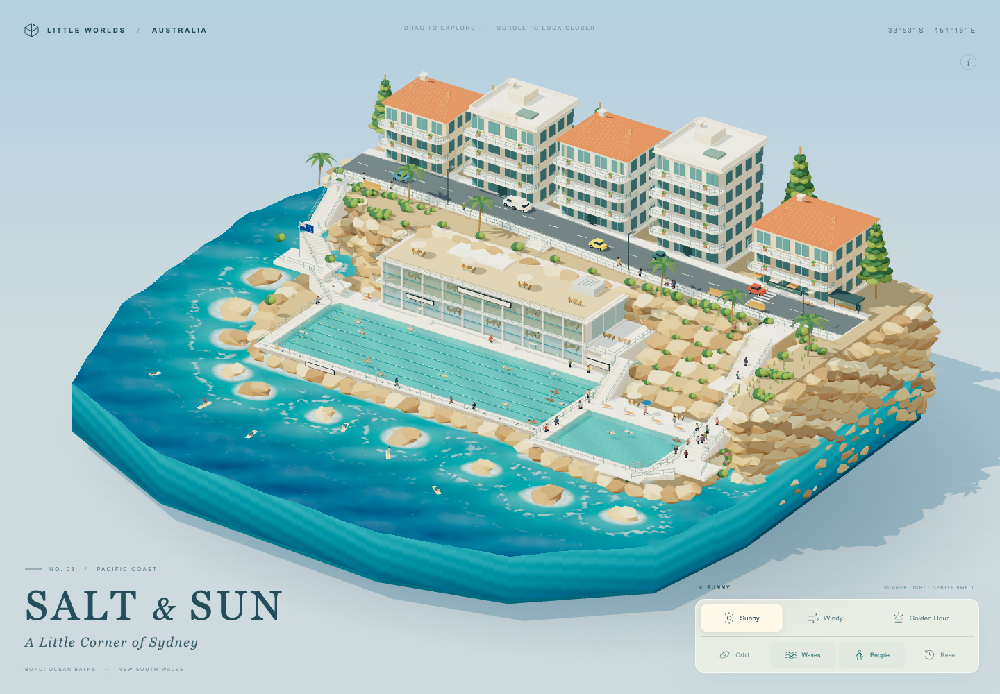
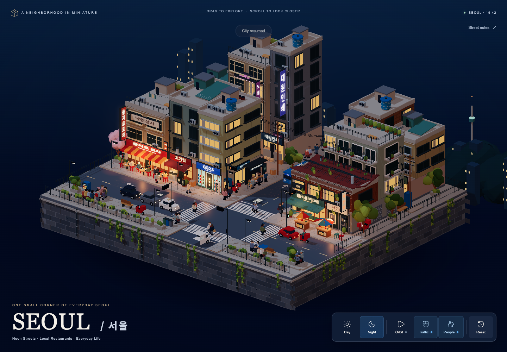
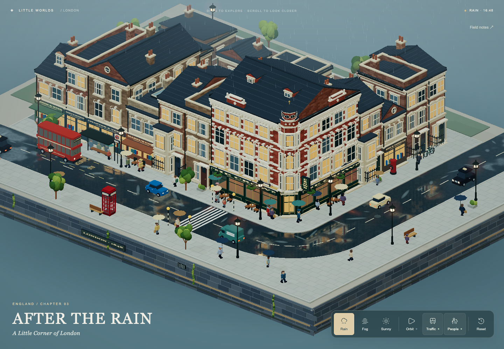
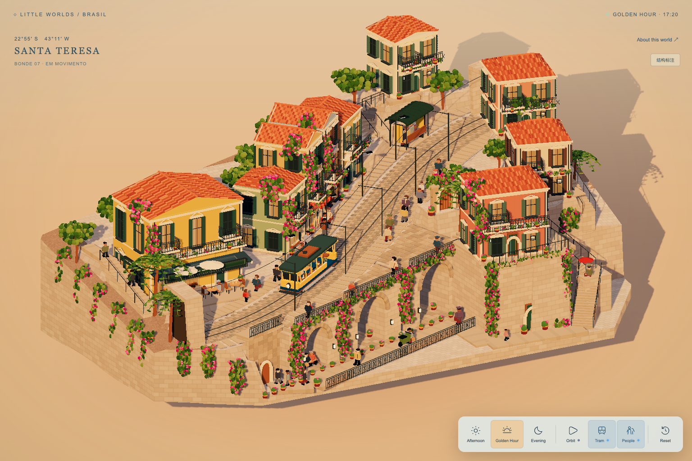
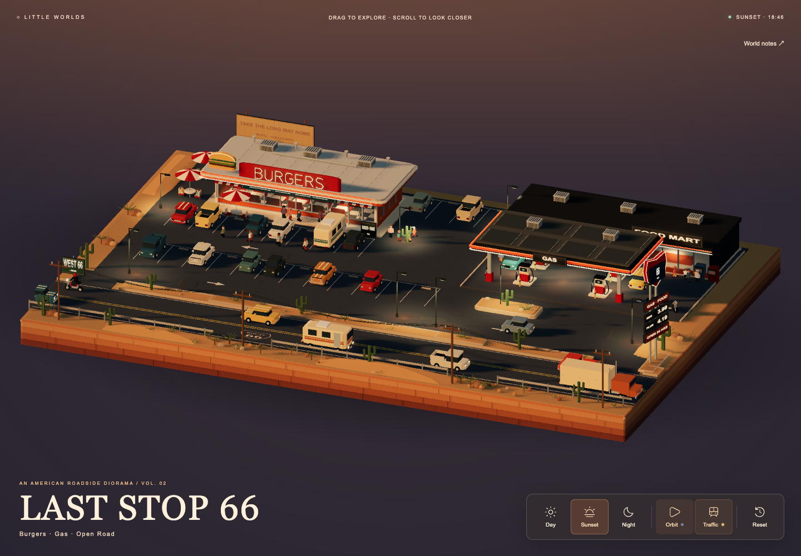

<div align="center">

# LITTLE WORLDS 3D

### 把一座城市的生活，装进一个可以探索的小世界。

**Interactive Three.js Dioramas · A Codex Skill**

[作品画廊](#作品画廊) · [快速开始](#快速开始) · [创作方式](#创作方式) · [技能文档](SKILL.md)

Three.js 0.180.0 &nbsp; / &nbsp; 程序化建模 &nbsp; / &nbsp; 可交互场景 &nbsp; / &nbsp; 离线 HTML

</div>



从最初首尔的霓虹街区，到 Route 66 的落日公路，到伦敦雨后的街角；从巴西山坡上的黄色电车，到悉尼海岸的浪花与泳池。

**Little Worlds 3D** 是一套带真实可运行代码的 Codex Skill：以离线 Three.js Starter 为基础，复用建筑、人物、车辆、灯光与交互系统，继续创作具有地方气质的微缩世界。最终可导出为一个独立 HTML 文件，在浏览器中旋转、缩放和探索。

> 下方均为已有作品的实际浏览器截图。作品展示了基于 Starter 继续扩展的结果；作品源码与离线成品不包含在本技能仓库中，仓库提供技能、通用 Starter 与参考文档。

## 作品画廊

### 00 / SEOUL · 서울

**Seoul, South Korea · 一切开始的街区**



最初的首尔微景，把韩文招牌、街边餐馆、便利店、屋顶水箱、暖色窗光与繁忙路口放在同一块悬浮街区里。白天与夜晚之间，建筑立面和街道生活呈现不同的表情。

- **街区细节**：餐馆与商铺、悬挑灯箱、霓虹招牌、屋顶设施和小型街景道具。
- **动态生活**：行人漫步、街边停留、公交停靠，以及受信号控制的车流与过街行为。
- **技能起点**：Little Worlds 3D 从这个项目提取并适配了几何、建筑、人物、车辆、灯光与模拟系统，再形成通用 Starter。首尔本身是技能的前身，首尔专用布局、韩文内容与背景没有被直接带入中性模板。

### 01 / SALT & SUN

**Sydney, Australia · 海岸、阳光与生活**

以 Bondi 海岸为灵感，将海洋、砂岩、双泳池、俱乐部和高位住宅连接成连续的微缩地形。步道人群、泳者、冲浪者和沿岸车辆，让建筑之间有了生活。

- **场景扩展**：海浪、岸线泡沫、局部越墙浪花、游泳与冲浪动作。
- **环境变化**：Sunny / Windy / Golden Hour。
- **复用基础**：Starter 运行时、人物与车辆工厂、灯光、几何工具和离线导出。

封面展示本作品的 Sunny 实机画面。

### 02 / AFTER THE RAIN

**London, England · 雨后的街角**



维多利亚式立面、街角酒馆、红色双层巴士与电话亭，共同构成一块可以环绕观看的伦敦街区。雨丝、窗光与局部积水倒影，让天气参与叙事。

- **场景扩展**：地方建筑立面、双层巴士、湿沥青和缓存镜像代理反射。
- **环境变化**：Rain / Fog / Sunny。
- **经验沉淀**：[湿路面反射指南](references/wet-road-reflections.md)记录代理选择、同帧更新、质量取舍与回退方式。反射是场景化扩展，需要按新作品的道路高度和布局接入。

### 03 / BONDE DA TARDE

**Santa Teresa, Brazil · 山坡上的午后电车**



黄色电车沿坡地街道穿过彩色住宅。红瓦屋顶、绿百叶窗、九重葛、咖啡馆和下层石砌拱廊，共同组织出有高差的街区生活。

- **场景扩展**：连续坡地轨道、电车模型与站点行为、多层路径和结构拱廊。
- **环境变化**：Afternoon / Golden Hour / Evening。
- **空间重点**：道路、建筑入口、站台、台阶与下层步道共享明确的标高关系。

### 04 / LAST STOP 66

**American Southwest · 公路尽头的落日驿站**



一间汉堡店、一座加油站、一条穿过沙漠的公路。霓虹招牌、停放车辆、房车、仙人掌与暖色路灯，把公路旅行中的短暂停留凝固成一块微缩切片。

- **场景扩展**：美式路边建筑、专用车辆、停车区与沙漠道具。
- **环境变化**：Day / Sunset / Night。
- **交互体验**：环绕观察、缩放、交通状态切换与镜头重置。

<details>
<summary>查看画廊截图记录</summary>

这些截图保留各作品某次已交付迭代的真实状态，不承诺与本地后续修改逐项同步。

| 图片 | 记录 |
| --- | --- |
| SEOUL · 서울 | 初始首尔项目的 Identity Night 画面 |
| SALT & SUN | 最终 QA 中的 Sunny 全景 |
| AFTER THE RAIN | 湿沥青表面修复后的反射检查画面 |
| BONDE DA TARDE | 单向电车调整阶段的默认视角 |
| LAST STOP 66 | V4.2 的 Sunset 全景 |

</details>

## 技能提供什么

| 层次 | 仓库内容 | 创作时的作用 |
| --- | --- | --- |
| 世界基础 | 运行时、相机、几何、材质、随机种子 | 从可运行的项目开始，保持场景可重复生成 |
| 建筑与街景 | 建筑工具、窗户、招牌、树木、长椅和路灯 | 组合并扩展地方建筑与街道细节 |
| 街区生活 | 人物、车辆与作者定义的路径模拟 | 为场景加入行走、交通和停靠行为 |
| 环境与交互 | 昼夜灯光、基础天气、工具栏、旋转与缩放 | 查看不同光照、天气与镜头下的世界 |
| 独立交付 | 本地 Three.js、服务器与 HTML 导出脚本 | 无需 npm 安装，导出可离线打开的作品 |
| 创作指南 | 美术方向、架构、表面深度稳定性、反射参考 | 扩展场景时沿用已积累的实现经验 |

海岸水体、巴西电车、伦敦镜像反射等展示能力来自对应作品的定制开发。Starter 自带的是中性演示场景；新的国家、建筑、地形与交通习惯仍需具体设计和实现。

## 快速开始

### 1. 安装到 Codex

需要 Git；直接初始化、启动和导出项目需要 Python 3。

```sh
git clone https://github.com/Gerahamu/little-worlds-3d.git ~/.codex/skills/little-worlds-3d
```

如果该目录已经存在，请先备份，避免覆盖已有版本。若配置了自定义 Codex 技能目录，请调整路径。

### 2. 在对话中提出创作需求

```text
使用 little-worlds-3d，制作一个葡萄牙海滨小镇的可交互微缩世界。
白墙红瓦、蓝色瓷砖、坡道与街角咖啡馆，加入行人与车辆。
提供白天和夜晚，支持旋转缩放，最后导出可离线打开的单文件 HTML。
```

也可以提供参考图，并说明要保留的构图、建筑风格、地形关系、动态元素和交付格式。

### 3. 手动初始化与运行

下面示例使用全新目录；初始化器会拒绝覆盖已存在的目标。

```sh
python3 ~/.codex/skills/little-worlds-3d/scripts/create-project.py \
  --name my-world \
  --destination "$PWD/my-world" \
  --title "My Little World" \
  --weather mist \
  --people 24 \
  --vehicles 4

python3 "$PWD/my-world/scripts/serve.py" --port 8768
```

在浏览器打开 `http://127.0.0.1:8768`。开发时通过本地服务器加载模块；离线交付使用下一步导出的单文件。

### 4. 导出独立 HTML

```sh
python3 "$PWD/my-world/scripts/export-html.py"
```

导出脚本会嵌入 JavaScript、CSS 和本地 Three.js，输出位置见终端提示。用支持 WebGL 2 和 Import Maps 的现代浏览器打开生成文件；修改源代码后需要重新导出。

## 创作方式

**先定义地方气质，再组织空间，最后加入生活。**

1. **确定主题**：地方建筑、时间、天气、色彩，以及想表现的一小段生活。
2. **组织空间**：先做地形、道路和建筑体块，检查高差、入口、转角和相机构图。
3. **延伸细节**：增加门窗、招牌、植物和道具，再设计人物车辆路径与场景专有动画。
4. **实际观看**：检查多个角度、连续环绕、不同光照和窄屏，确认运动、遮挡与表面稳定性。
5. **独立交付**：重新导出，再检查离线 HTML 本身。

主要编辑 `scene.js` 中的场景布局，以及 `project.config.js` 中的种子、镜头、天气、灯光与数量。公共系统放在 `src/`，场景专有逻辑应保持独立，便于后续复用。

## 仓库结构

```text
little-worlds-3d/
├── SKILL.md                 # 技能入口与工作流程
├── agents/                  # Codex 技能界面配置
├── assets/starter/          # 可运行的离线 Three.js 起始项目
│   ├── scene.js             # 场景布局
│   ├── project.config.js    # 世界与画面配置
│   ├── src/                 # 核心、建筑、角色、模拟与界面
│   ├── vendor/              # Three.js 与许可证
│   └── scripts/             # 本地服务与离线导出
├── scripts/                 # 新项目初始化工具
├── references/              # 架构、美术方向、实现经验与历史验证
└── docs/gallery/            # 已有作品的真实截图
```

## 深入阅读

- [完整技能说明](SKILL.md)：从初始化到离线交付的工作流程。
- [架构与接口](references/architecture.md)：模块约定、路径与信号系统边界。
- [美术方向](references/art-direction.md)：为不同地方组织建筑与场景语言。
- [表面深度稳定性](references/surface-depth-stability.md)：避免立面、车辆与贴附细节闪烁。
- [湿路面反射](references/wet-road-reflections.md)：缓存代理、道路合成与性能取舍。
- [提取与复用说明](references/extraction.md) / [来源记录](references/provenance.json)：原始实现与适配边界。
- [历史验证记录](references/validation.md)：已执行的检查及其限制。

## 使用边界与来源

模拟基于作者定义的路径，通用信号系统支持一个共享受控冲突区域。多个独立路口、导航网格、不同国家驾驶规则和新的专用交通工具，需要额外实现。画廊作品属于艺术化微缩创作，不作为测绘级复原。

Three.js 0.180.0 随仓库本地提供，其 MIT 许可证保留于 [vendor/three/LICENSE](assets/starter/vendor/three/LICENSE)，依赖记录见 [DEPENDENCIES.json](assets/starter/vendor/DEPENDENCIES.json)。保留第三方署名与来源记录。

---

<div align="center">

**Small worlds. Everyday stories.**  
用建筑定义一处地方，用光线和生活让它成为一个世界。

</div>
